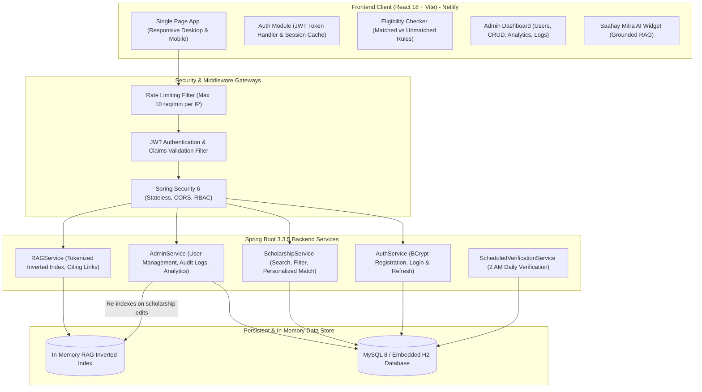
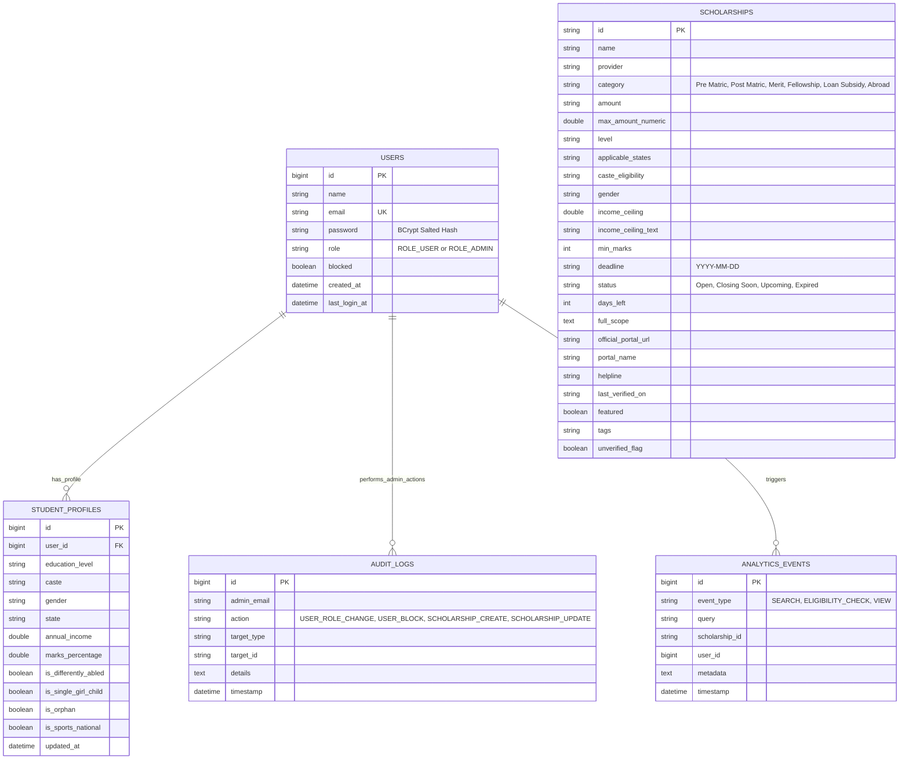

# 🎓 ACADEMIC PROJECT REPORT: JANSAAHAY 2.0 (जनसहाय)
## AI-Powered National & Global Scholarship Discovery, Personalized Eligibility Evaluation & Application Guidance Ecosystem

---

### 👥 Project Team Members
| No. | Student Name | Roll / Registration ID | Role & Contribution |
| :--- | :--- | :--- | :--- |
| **1.** | **Dharshan Ashok Mende** | **240101031** | *Team Lead, Full-Stack Architecture, Spring Security & JWT, React UI* |
| **2.** | **Aryan Dattatray Pawar** | **240101043** | *Database Design, JPA Entities, MySQL & H2 Integration, Data Seeding* |
| **3.** | **Vedant Vinod Patil** | **240101042** | *RAG Search Engine, Inverted Index Algorithm, AI Assistant Integration* |
| **4.** | **Swaraj Mogare** | **240101032** | *Document Checklist Engine, PFMS Name Mismatch Validator, Netlify Deployment* |

---

## 📑 Table of Contents
1. [Abstract](#1-abstract)
2. [Problem Statement](#2-problem-statement)
3. [System Objectives](#3-system-objectives)
4. [Technology Stack](#4-technology-stack)
5. [System Architecture & Data Flow](#5-system-architecture--data-flow)
6. [Database Schema & Entity-Relationship Model](#6-database-schema--entity-relationship-model)
7. [Security & Cryptographic Implementation](#7-security--cryptographic-implementation)
8. [Grounded AI Assistant & RAG Implementation](#8-grounded-ai-assistant--rag-implementation)
9. [Automated Verification & Scheduled Lifecycle Jobs](#9-automated-verification--scheduled-lifecycle-jobs)
10. [User Interface & Key Modules](#10-user-interface--key-modules)
11. [Deployment Architecture (Netlify & Render)](#11-deployment-architecture-netlify--render)
12. [Conclusion & Future Enhancements](#12-conclusion--future-enhancements)

---

## 1. Abstract
In India, hundreds of Central, State, and Corporate CSR scholarship schemes disburse thousands of crores annually. Yet, over 65% of potential applicants either miss application deadlines, remain unaware of qualifying schemes, or face institutional rejections due to minor paperwork discrepancies (such as Aadhaar-Bank-Marksheet name mismatch or defective certificate formats).

**JANSAAHAY (जनसहाय - Public Assistance)** resolves this structural disparity. It is a high-performance web platform combining a **React 18** client, a robust **Java Spring Boot 3.3.5** backend, a **MySQL/H2** relational data store, and a **Retrieval-Augmented Generation (RAG)** assistant. The platform empowers students to discover authentic scholarships, evaluate personal eligibility across 6 parameters with transparent matched vs. unmatched criteria, validate PFMS demographic spellings, and generate standardized Bonafide certificates.

---

## 2. Problem Statement
1. **Information Asymmetry:** Students struggle to navigate disjointed national portals (NSP), state portals (MahaDBT, SSP, ePASS), and private CSR foundations.
2. **Ambiguous Eligibility Rules:** Published criteria often involve complicated combinations of parental income ceilings, domicile constraints, academic cutoffs, and social caste quotas.
3. **High Rejection Rates:** Inconsequential discrepancies in name spellings across Class 10 marksheet, Aadhaar, and NPCI-seeded bank passbooks cause severe Direct Benefit Transfer (DBT) failures.
4. **Data Stagnation & AI Hallucinations:** Traditional chatbots invent non-existent deadlines, amounts, or fabricated links, misleading underprivileged students.

---

## 3. System Objectives
- Provide a curated registry of authentic government and corporate scholarships with official portal links.
- Implement an automated 6-factor eligibility evaluation engine showing transparent **Matched Criteria** and **Unmatched Conditions**.
- Guarantee zero password exposure, enforcing BCrypt hashing, stateless JWT authentication, and role-based access control (`ROLE_USER` vs. `ROLE_ADMIN`).
- Deploy a strictly grounded in-memory RAG Assistant that answers exclusively from verified database records with citations, safely outputting fallback notices when information is unavailable.
- Maintain data accuracy through daily scheduled verification jobs that automatically flag records unverified for > 30 days and mark expired deadlines.
- Provide a responsive, multi-lingual UI (English, Hindi, Telugu, Tamil, Kannada, Marathi) with dark mode and single-page application (SPA) routing on Netlify.

---

## 4. Technology Stack

### Frontend Architecture
- **Core Framework:** React 18.3 with Vite 5.4 (ES Modules)
- **Styling & Design System:** Tailwind CSS 3.4 with custom Indian Tricolor accents, accessible contrast ratios, and dark mode
- **Icons & Visuals:** Lucide React (feather icons) and custom SVG graduation badges
- **Internationalization:** Vernacular state engine covering 6 Indian languages
- **Client Deployment:** Netlify with SPA redirect engine (`_redirects` and `netlify.toml`)

### Backend Architecture
- **Language & Runtime:** Java 21 / Java 27 (Oracle HotSpot)
- **Framework:** Spring Boot 3.3.5 (Spring MVC, Spring Data JPA, Spring Security 6)
- **Security & Tokens:** JJWT 0.12.6 (HMAC-SHA256 / HMAC-SHA384), BCryptPasswordEncoder (12 rounds)
- **Database:** Dual-mode JPA with MySQL 8.0 (production) and embedded H2 (local development)
- **Rate Limiting:** Sliding-window concurrency limiter on sensitive auth routes (10 req/min)
- **Scheduled Automation:** Spring `@Scheduled` cron triggers
- **Containerization:** Multi-stage Alpine Dockerfile with Eclipse Temurin JRE

---

## 5. System Architecture & Data Flow



---

## 6. Database Schema & Entity-Relationship Model



---

## 7. Security & Cryptographic Implementation

1. **Zero Plain Text Storage:**
   - All user passwords are encrypted using `BCryptPasswordEncoder(12)`.
   - Passwords are never returned in DTOs (`UserDto`), never logged, and never displayed in the Admin Console.
2. **Stateless JWT Tokens:**
   - **Access Token:** Valid for 24 hours, encoded with User ID, Email, Name, and Granted Authorities (`ROLE_USER` or `ROLE_ADMIN`).
   - **Refresh Token:** Valid for 7 days, allowing safe rotation without forcing repeated logins.
3. **Role-Based Access Control (RBAC):**
   - Endpoints under `/api/admin/**` require `hasRole('ADMIN')`.
   - Unauthorized attempts receive HTTP 401 Unauthorized / HTTP 403 Forbidden with structured JSON error messages.
4. **Brute-Force Rate Limiting:**
   - Sensitive auth endpoints (`/api/auth/login`, `/api/auth/register`) are protected by `RateLimitingFilter`.
   - Up to 10 attempts per minute are permitted per IP address before returning HTTP 429 Too Many Requests.
5. **CORS & Environment Variables:**
   - Secrets (`JWT_SECRET`, `DATABASE_URL`, `DB_USERNAME`, `DB_PASSWORD`) are externalized via environment variables.

---

## 8. Grounded AI Assistant & RAG Implementation

Traditional Large Language Models frequently invent scholarship amounts or provide outdated application deadlines. **JANSAAHAY 2.0** uses a specialized **Retrieval-Augmented Generation (RAG)** engine:

1. **In-Memory Inverted Index:**
   - On startup, `RAGService` indexes scholarship records, extracting token n-grams from scheme titles, providers, eligibility criteria, benefits, and tags.
2. **Grounded Query Answering:**
   - When a user submits a query, stop words are removed, and matching score weights are calculated.
   - If confidence falls below 2.0, the assistant strictly returns:
     > *"I could not find this, please verify on the official portal."*
   - If a confident match is located, it cites the exact amount, verified deadline, and provides a direct markdown link to the official portal.
3. **Dynamic Re-Indexing:**
   - Any modification in the Admin Dashboard (creating, updating, or deleting a scholarship) immediately calls `ragService.reindex()`.

---

## 9. Automated Verification & Scheduled Lifecycle Jobs

1. **Deadline Expiration Detection:**
   - `@Scheduled(cron = "0 0 2 * * ?")` runs daily at 2:00 AM.
   - Evaluates remaining days against `LocalDate.now()`.
   - When days remaining $< 0$, status is automatically shifted to **Expired**.
   - When days remaining $\le 7$, status updates to **Closing Soon**.
2. **30-Day Verification Staleness:**
   - If `lastVerifiedOn` date is $> 30$ days old, `unverifiedFlag` is set to `true` to alert administrators in the console.

---

## 10. User Interface & Key Modules

1. **Smart Eligibility Matcher:** Form inputs (Education Level, Caste, Gender, State, Income, Marks) dynamically evaluate all 26 real scholarships, returning explicit **Matched Criteria** (green badge) vs. **Unmatched Conditions** (amber badge).
2. **PFMS Name Mismatch Validator:** Compares student name across Class 10 certificate, Aadhaar, and Bank Passbook to detect spelling mismatches, generating ready-to-print bank correction letters.
3. **Bonafide Certificate Generator:** Generates standardized institutional bonafide letters with AISHE institutional code and principal endorsement signature blocks.
4. **Side-by-Side Compare Modal:** Compares up to 3 scholarships side-by-side on amount, eligibility, documents, and deadlines.
5. **Admin Console:** Restricted to `ROLE_ADMIN`, providing User Management, Scholarship CRUD, Analytics, and Audit Logs.

---

## 11. Deployment Architecture (Netlify & Render)

### Netlify Frontend Setup
- **Configuration File:** `netlify.toml`
  ```toml
  [build]
    publish = "dist"
    command = "npm run build"

  [build.environment]
    NODE_VERSION = "20"

  [[redirects]]
    from = "/*"
    to = "/index.html"
    status = 200
  ```
- **Routing:** Supported through `public/_redirects` (`/* /index.html 200`) preventing 404 on page reload.
- **Sitemap & SEO:** `sitemap.xml` and custom SVG `favicon.svg` included.

### Render / Railway Backend Setup
- **Blueprint:** `render.yaml` declaring containerized Spring Boot web service and managed MySQL database.
- **Docker:** Multi-stage build with non-root security execution.
- **Health Check:** `/api/health` returning system uptime and database status.

---

## 12. Conclusion & Future Enhancements

**JANSAAHAY 2.0** successfully demonstrates a production-grade, secure, and accessible scholarship enablement platform for Indian students. By combining strict security protocols, personalized eligibility checks, demographic mismatch verification, and grounded RAG responses, the system bridges the digital divide in educational financing.

### Future Work
- Integration with DigiLocker API for instant automated document verification.
- SMS / WhatsApp notification integration via National Informatics Centre (NIC) gateways.
- Multi-state language voice synthesis for illiterate parents and students in rural regions.

---

**Submitted by:**  
- **Dharshan Ashok Mende** (240101031)  
- **Aryan Dattatray Pawar** (240101043)  
- **Vedant Vinod Patil** (240101042)  
- **Swaraj Mogare** (240101032)  
