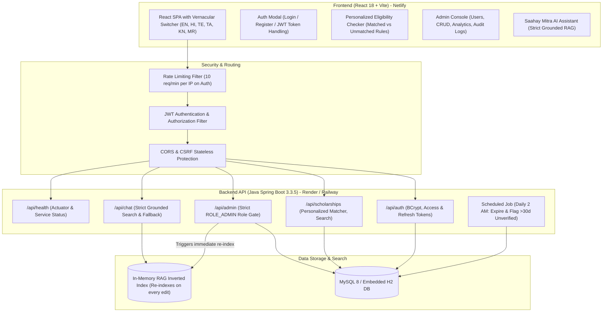
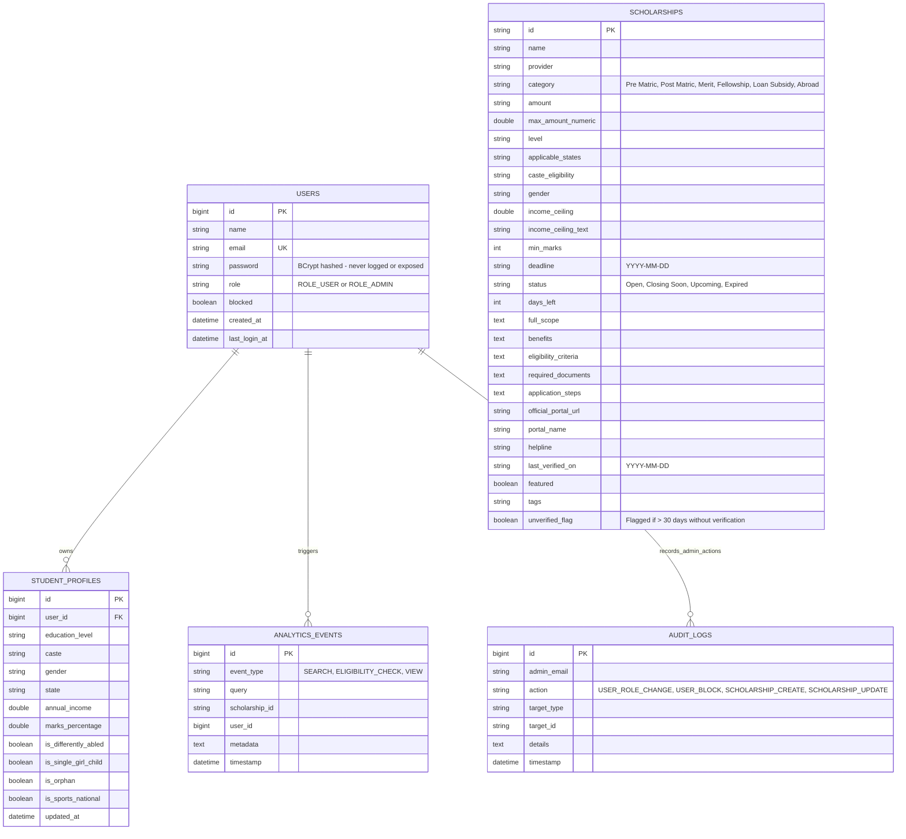

# 🎓 JANSAAHAY 2.0 (जनसहाय)
### National & Global Scholarship Discovery, Personalized Eligibility, Document Checklist & Application Guidance Platform

> **Live Deployment:** [https://jansaha.netlify.app](https://jansaha.netlify.app)  
> **Backend API:** Java Spring Boot 3.3.5, Spring Security 6, JWT, JPA / Hibernate, MySQL & H2 fallback, RAG Engine  
> **Frontend:** React 18, Vite, Tailwind CSS, Lucide React  
> **Maintainer / GitHub:** [@dharshanmende-afk](https://github.com/dharshanmende-afk/JANSAHAY-2)  

---

## 🏛️ System Architecture



---

## 🗄️ Database Entity-Relationship (ER) Diagram



---

## 🔒 Security Architecture
1. **BCrypt Password Hashing:** 12-round BCrypt cryptographic salt hashing. No plain text password is ever stored, logged, or returned in any DTO or API response.
2. **Stateless JWT Authentication:**
   - Short-lived Access Token (24 hours) with user ID, email, and granted roles.
   - Refresh Token (7 days) for seamless token renewals.
3. **Role-Based Access Control (RBAC):**
   - Public APIs: `/api/auth/**`, `GET /api/scholarships/**`, `/api/scholarships/check-eligibility`, `/api/chat`, `/api/health`.
   - Admin-Only APIs: `/api/admin/**` guarded with `@PreAuthorize("hasRole('ADMIN')")` and Spring Security filter chains.
4. **Login Rate Limiter:** Sensitive endpoints (`/api/auth/login`, `/api/auth/register`) enforce an IP-based sliding window rate limiter (max 10 requests per minute). Returns HTTP 429 upon violation.
5. **CORS & Environment Isolation:** Secrets (`JWT_SECRET`, `DATABASE_URL`, `DB_USERNAME`, `DB_PASSWORD`) are loaded via environment variables with safe dev fallbacks.

---

## 🔑 Default Seeded Accounts

| Role | Email | Password | Permissions |
| :--- | :--- | :--- | :--- |
| **National Administrator** | `admin@jansaahay.gov.in` | `Admin@JanSaahay2026` | Full Admin Console, User Role/Block/Delete, Scholarship CRUD, Analytics, Audit Logs |
| **Student (Demo User)** | `student@jansaahay.gov.in` | `Student@JanSaahay2026` | Personalized Eligibility Matcher, Document Readiness, Application Tracker |

*(One-click auto-fill buttons are provided in the UI Auth Modal for instant evaluation).*

---

## 📡 REST API Specification

### Authentication (`/api/auth`)
| Method | Endpoint | Description | Auth Required |
| :--- | :--- | :--- | :--- |
| `POST` | `/api/auth/register` | Register new student account | None |
| `POST` | `/api/auth/login` | Login, returns JWT access & refresh tokens | Rate Limited |
| `POST` | `/api/auth/refresh` | Exchange refresh token for new access token | Refresh Token |
| `GET` | `/api/auth/me` | Fetch authenticated user profile (no password) | Bearer Token |

### Scholarships & Eligibility (`/api/scholarships`)
| Method | Endpoint | Description | Auth Required |
| :--- | :--- | :--- | :--- |
| `GET` | `/api/scholarships` | Search & list scholarships with optional filters | None |
| `GET` | `/api/scholarships/{id}` | Get detailed scholarship record | None |
| `POST` | `/api/scholarships/check-eligibility` | Personalized matching with matched vs unmatched breakdown | Optional |

### AI Assistant with RAG (`/api/chat`)
| Method | Endpoint | Description | Auth Required |
| :--- | :--- | :--- | :--- |
| `POST` | `/api/chat` | Query RAG assistant; cites verified official links, outputs strict fallback if unsure | None |

### Administration (`/api/admin`) - Restricted to `ROLE_ADMIN`
| Method | Endpoint | Description | Auth Required |
| :--- | :--- | :--- | :--- |
| `GET` | `/api/admin/users` | List all users with search/filter (passwords hidden) | Admin |
| `PUT` | `/api/admin/users/{id}/role` | Promote/demote user (`ROLE_USER` <-> `ROLE_ADMIN`) | Admin |
| `PUT` | `/api/admin/users/{id}/block` | Block or unblock a user account | Admin |
| `DELETE` | `/api/admin/users/{id}` | Delete a user account | Admin |
| `POST` | `/api/admin/scholarships` | Create new scholarship (triggers RAG re-index) | Admin |
| `PUT` | `/api/admin/scholarships/{id}` | Update scholarship (triggers RAG re-index) | Admin |
| `DELETE` | `/api/admin/scholarships/{id}` | Delete scholarship (triggers RAG re-index) | Admin |
| `GET` | `/api/admin/analytics` | Summary metrics: users, searches, checks, deadlines | Admin |
| `GET` | `/api/admin/audit-logs` | Immutable audit log of administrative actions | Admin |

### Health & Monitoring
| Method | Endpoint | Description | Auth Required |
| :--- | :--- | :--- | :--- |
| `GET` | `/api/health` | Live system health status, DB connectivity, record count | None |

---

## 📚 Seed Data Catalog (26 Real Curated Scholarships)

1. **PM-USP Central Sector Scheme** — Ministry of Education | Category: *Merit* | ₹20,000/yr | [scholarships.gov.in](https://scholarships.gov.in)
2. **Centrally Sponsored Post-Matric SC/ST/OBC** — Ministry of Social Justice | Category: *Post Matric* | 100% Tuition Fee | [scholarships.gov.in](https://scholarships.gov.in)
3. **Centrally Sponsored Pre-Matric SC/ST** — Ministry of Social Justice | Category: *Pre Matric* | ₹7,000/yr | [scholarships.gov.in](https://scholarships.gov.in)
4. **AICTE Pragati Scheme for Girls** — AICTE | Category: *Merit* | ₹50,000/yr | [aicte-india.org](https://www.aicte-india.org)
5. **AICTE Saksham for Specially-Abled (PwD)** — AICTE | Category: *Merit* | ₹50,000/yr | [aicte-india.org](https://www.aicte-india.org)
6. **AICTE Swanath for Orphans & Martyrs' Wards** — AICTE | Category: *Merit* | ₹50,000/yr | [aicte-india.org](https://www.aicte-india.org)
7. **CSIR-UGC NET Junior Research Fellowship (JRF)** — CSIR / NTA | Category: *Fellowship* | ₹37,000/mo + HRA | [csirnet.nta.nic.in](https://csirnet.nta.nic.in)
8. **Prime Minister's Research Fellowship (PMRF)** — Ministry of Education | Category: *Fellowship* | ₹80,000/mo + ₹2L/yr grant | [pmrf.in](https://www.pmrf.in)
9. **Dr. Ambedkar Interest Subsidy on Overseas Loans** — Ministry of Social Justice | Category: *Loan Subsidy* | 100% Interest Subsidy | [socialjustice.gov.in](https://socialjustice.gov.in)
10. **Padho Pardesh Overseas Loan Interest Subsidy** — Ministry of Minority Affairs | Category: *Loan Subsidy* | Full Interest Waiver | [minorityaffairs.gov.in](https://minorityaffairs.gov.in)
11. **National Overseas Scholarship (NOS) for SC** — Ministry of Social Justice | Category: *Abroad* | Full Tuition + $15,400/yr + Airfare | [nosmsje.gov.in](https://nosmsje.gov.in)
12. **Fulbright-Nehru Master's & Doctoral Fellowships** — USIEF | Category: *Abroad* | Full US Tuition + Stipend + Visa | [usief.org.in](https://www.usief.org.in)
13. **Chevening UK Scholarships for Indian Scholars** — UK FCDO | Category: *Abroad* | 100% UK Master's Fees + Flights | [chevening.org](https://www.chevening.org/scholarship/india/)
14. **MahaDBT Rajarshi Chhatrapati Shahu Maharaj Yojna** — Govt of Maharashtra | Category: *Post Matric* | 50% Fee Reimbursement | [mahadbt.maharashtra.gov.in](https://mahadbt.maharashtra.gov.in)
15. **Karnataka Vidyasiri Food & Accommodation** — Govt of Karnataka | Category: *Post Matric* | ₹15,000/yr + Fee Waiver | [ssp.postmatric.karnataka.gov.in](https://ssp.postmatric.karnataka.gov.in)
16. **UP Post-Matric Scholarship & Fee Reimbursement** — Govt of Uttar Pradesh | Category: *Post Matric* | 100% Course Fee Reimbursement | [scholarship.up.gov.in](https://scholarship.up.gov.in)
17. **West Bengal OASIS Post-Matric Scholarship** — Govt of West Bengal | Category: *Post Matric* | Maintenance + Tuition | [oasis.gov.in](https://oasis.gov.in)
18. **Bihar PMS Online Post Matric Scheme** — Govt of Bihar | Category: *Post Matric* | Full Approved Fee | [pmsonline.bih.nic.in](https://pmsonline.bih.nic.in)
19. **Telangana ePASS RTF & MTF Reimbursement** — Govt of Telangana | Category: *Post Matric* | 100% RTF Tuition + MTF Mess | [telanganaepass.cgg.gov.in](https://telanganaepass.cgg.gov.in)
20. **Reliance Foundation Undergraduate Scholarships** — Reliance Foundation CSR | Category: *Merit* | Up to ₹2,00,000 | [scholarships.reliancefoundation.org](https://www.scholarships.reliancefoundation.org)
21. **HDFC Bank Parivartan's ECSS Programme** — HDFC Bank CSR | Category: *Merit* | ₹75,000/yr | [hdfcbank.com](https://www.hdfcbank.com)
22. **Tata Trusts Means-Grant & Professional Scholarships** — Tata Trusts | Category: *Merit* | Up to 80% Tuition Fee | [tatatrusts.org](https://www.tatatrusts.org)
23. **Kotak Kanya Scholarship for Girls in Professional Courses** — Kotak Education | Category: *Merit* | ₹1,50,000/yr | [kotakeducation.org](https://www.kotakeducation.org)
24. **L'Oréal India For Young Women in Science** — L'Oréal CSR | Category: *Merit* | ₹2,50,000 | [loreal.com](https://www.loreal.com/en/india/)
25. **Santoor Women's Scholarship for Higher Education** — Wipro Cares | Category: *Merit* | ₹24,000/yr | [santoorscholarship.com](https://www.santoorscholarship.com)
26. **SBI Foundation Asha Scholarship** — SBI Foundation | Category: *Merit* | ₹50,000/yr | [sbifoundation.in](https://www.sbifoundation.in)

---

## 🚀 How to Run Locally

### 1. Run Spring Boot Backend
```bash
cd backend
# Using Maven wrapper or local Maven:
mvn spring-boot:run
# Server starts at http://localhost:8080 (Health check: http://localhost:8080/api/health)
```

### 2. Run React Frontend
```bash
# In the project root:
npm install
npm run dev
# Vite runs at http://localhost:3000
```

---

## ☁️ Deployment Guide

- **Netlify (Frontend):**
  - Continuous deployment configured with `public/_redirects` (`/* /index.html 200`) for seamless client-side SPA routing.
  - Live at `https://jansaha.netlify.app`.
- **Render / Railway (Backend):**
  - `render.yaml` provided for automated zero-config setup with managed MySQL database.
  - Multi-stage `backend/Dockerfile` with non-root security container.
  - Health check configured on `/api/health`.
